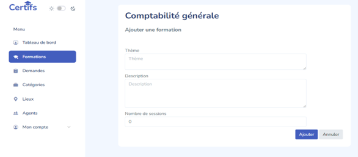

# Certif FRK — Gestion des formations (Trésor Public)

Application de gestion des formations professionnelles réalisée pour le **Trésor Public**. Elle permet de gérer les formations, les sessions, les lieux, les inscriptions, les présences et les demandes d'attestation pour un réseau d'environ **7 000 agents**.



## Stack

- **Framework** : Laravel 11 (PHP 8.2 / 8.3)
- **Frontend** : Blade, Alpine.js, Tailwind CSS, Vite
- **Base de données** : MySQL
- **Auth** : Laravel Breeze, rôles et middleware personnalisé
- **Tests** : Pest / PHPUnit
- **i18n** : FR / EN (`laravel-lang`)

## Rôles

| Rôle | Accès |
|---|---|
| `admin` | Administration complète, gestion des agents |
| `superviseur` | Gestion des formations, sessions, présences, demandes |
| `participant` | Consultation de ses formations, inscriptions, demandes d'attestation |

Le contrôle d'accès est centralisé dans le middleware `EnsureUsersHasRole`.

## Fonctionnalités

- Authentification multi-rôles avec Laravel Breeze
- CRUD des formations, catégories, lieux et sessions
- Gestion des inscriptions aux sessions
- Gestion des présences et des participants présents
- Demandes d'attestation et génération des documents
- Tableau de bord des sessions
- Gestion des agents (admin)
- Internationalisation FR / EN
- Tests avec Pest

## Lancer le projet

> Utiliser **PHP 8.2 ou 8.3** : les dépendances verrouillées ne sont pas compatibles avec PHP 8.4.

```bash
composer install
npm install
```

Créer le fichier d'environnement et la clé d'application :

```bash
copy .env.example .env
php artisan key:generate
```

Configurer MySQL dans `.env` :

```env
DB_CONNECTION=mysql
DB_HOST=127.0.0.1
DB_PORT=3306
DB_DATABASE=certif
DB_USERNAME=root
DB_PASSWORD=
```

Appliquer les migrations et les seeders :

```bash
php artisan migrate --seed
```

Lancer le frontend et le serveur :

```bash
npm run dev
php artisan serve
```

L'application est disponible sur `http://127.0.0.1:8000`.

## Structure

```text
app/
  Http/
    Controllers/       # Formation, Sessionpro, Presence, Demande, Profil...
    Middleware/        # EnsureUsersHasRole
  Models/              # Formation, Sessionpro, Categorie, Lieu, Presence, Demande, User
database/
  migrations/          # Schéma MySQL
  seeders/             # Données de démonstration
resources/
  views/               # Blade (dashboard, formations, sessions, présences...)
routes/
  web.php              # Routes et guards de rôles
public/
  lang/french.json     # Traductions
```

## Sécurité

- Aucun fichier `.env` réel n'est versionné : seul `.env.example` est présent.
- Les mots de passe sont hachés via Laravel Breeze.
- Les routes sensibles sont protégées par `auth`, `verified` et `EnsureUsersHasRole`.

## Auteur

Russell Dossou-Yovo — [GitHub](https://github.com/russell-sedj)
