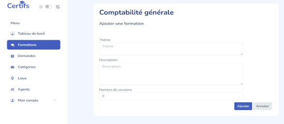

# Certif FRK — Gestion des formations (Trésor Public)

Application de gestion des formations professionnelles réalisée pour le **Trésor Public**. Elle permet de gérer les formations, les sessions, les lieux, les inscriptions, les présences et les demandes d'attestation pour un réseau d'environ **7 000 agents**.



## Démo publique

> **Démonstration — données fictives.** La démo est en ligne : [certif-frk.alwaysdata.net](https://certif-frk.alwaysdata.net). Elle est remise à zéro chaque nuit.

| Rôle | Email | Mot de passe |
|---|---|---|
| Administrateur | `admin@demo.certifs.test` | `Demo1234!` |
| Superviseur | `superviseur@demo.certifs.test` | `Demo1234!` |
| Participant | `participant@demo.certifs.test` | `Demo1234!` |

La page de connexion propose aussi trois boutons d'accès direct. Les attestations générées portent un filigrane **SPÉCIMEN — DÉMO**.

- Guide de déploiement : [docs/DEPLOY_ALWAYSDATA.md](docs/DEPLOY_ALWAYSDATA.md)
- Présentation portfolio : [docs/PORTFOLIO.md](docs/PORTFOLIO.md)

## Stack

- **Framework** : Laravel 11 (PHP 8.2 / 8.3)
- **Frontend** : Blade, Alpine.js, Tailwind CSS, Vite
- **Base de données** : MySQL
- **Auth** : Laravel Breeze, rôles et middleware personnalisé
- **Tests** : Pest / PHPUnit
- **i18n** : FR / EN (`laravel-lang`)

## Rôles

| Rôle | Accès |
|---|---|
| `admin` | Administration complète, gestion des agents |
| `superviseur` | Gestion des formations, sessions, présences, demandes |
| `participant` | Consultation de ses formations, inscriptions, demandes d'attestation |

Le contrôle d'accès est centralisé dans le middleware `EnsureUsersHasRole`.

## Fonctionnalités

- Authentification multi-rôles avec Laravel Breeze
- CRUD des formations, catégories, lieux et sessions
- Gestion des inscriptions aux sessions
- Gestion des présences et des participants présents
- Demandes d'attestation et génération des documents
- Tableau de bord des sessions
- Gestion des agents (admin)
- Internationalisation FR / EN
- Tests avec Pest

## Lancer le projet

> Utiliser **PHP 8.2 ou 8.3** : les dépendances verrouillées ne sont pas compatibles avec PHP 8.4.

```bash
composer install
npm install
```

Créer le fichier d'environnement et la clé d'application :

```bash
copy .env.example .env
php artisan key:generate
```

Configurer MySQL dans `.env` :

```env
DB_CONNECTION=mysql
DB_HOST=127.0.0.1
DB_PORT=3306
DB_DATABASE=certif
DB_USERNAME=root
DB_PASSWORD=
```

Appliquer les migrations et les seeders :

```bash
php artisan migrate --seed
```

Le seeder par défaut charge le jeu de données de démonstration (`DemoSeeder`). Les trois comptes de démo sont créés avec le mot de passe `Demo1234!`.

Lancer le frontend et le serveur :

```bash
npm run dev
php artisan serve
```

L'application est disponible sur `http://127.0.0.1:8000`.

## Structure

```text
app/
  Http/
    Controllers/       # Formation, Sessionpro, Presence, Demande, Profil...
    Middleware/        # EnsureUsersHasRole
  Models/              # Formation, Sessionpro, Categorie, Lieu, Presence, Demande, User
database/
  migrations/          # Schéma MySQL
  seeders/             # Données de démonstration
resources/
  views/               # Blade (dashboard, formations, sessions, présences...)
routes/
  web.php              # Routes et guards de rôles
public/
  lang/french.json     # Traductions
```

## Mode démo

Le mode démo est activé par `DEMO_MODE=true` dans `.env`. Il ajoute :

- trois comptes fixes et des boutons de connexion directe sur la page de login ;
- une bannière « DÉMO — données fictives » et un bouton de réinitialisation ;
- la commande `php artisan demo:reset`, qui relance `migrate:fresh` et `DemoSeeder` ;
- un filigrane « SPÉCIMEN — DÉMO » sur les attestations.

En production, un cron quotidien lance :

```bash
cd /home/<compte>/www/certif && php artisan demo:reset --force
```

> Sur alwaysdata, le PHP CLI par défaut peut être en 8.4. Utiliser le binaire 8.3 explicite (voir [docs/DEPLOY_ALWAYSDATA.md](docs/DEPLOY_ALWAYSDATA.md)) ou passer l'environnement en PHP 8.3.

## Sécurité

- Aucun fichier `.env` réel n'est versionné : seul `.env.example` est présent.
- Les mots de passe sont hachés via Laravel Breeze.
- Les routes sensibles sont protégées par `auth`, `verified` et `EnsureUsersHasRole`.

## Auteur

Russell Dossou-Yovo — [GitHub](https://github.com/russell-sedj)
