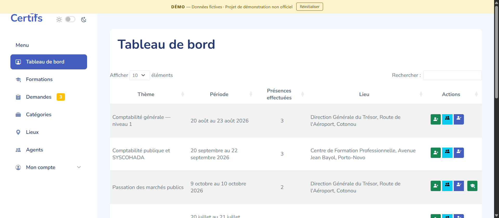
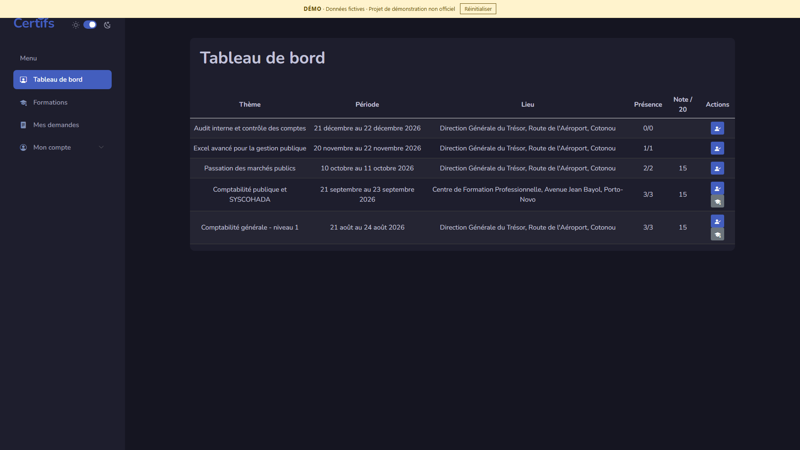
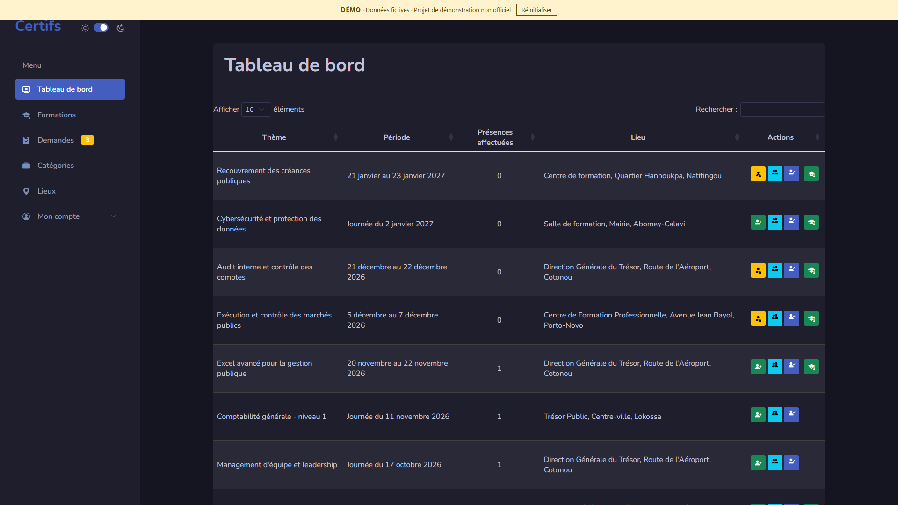

# Certif FRK - fiche portfolio

> Application de gestion des formations professionnelles pour un réseau d'environ **7 000 agents**.
> Projet présenté en démonstration publique avec des **données fictives**.

- **Démo** : [test-rvss.alwaysdata.net/certif](https://test-rvss.alwaysdata.net/certif/)
- **Code** : [github.com/russell-sedj/certif_frk](https://github.com/russell-sedj/certif_frk)
- **Rôle** : conception et développement full-stack
- **Stack** : Laravel 11, PHP 8.3, MySQL, Blade, Alpine.js, Tailwind CSS, Vite, Pest
- **Contexte** : application métier pour la gestion des formations, sessions, inscriptions, présences et attestations

## En bref

| | |
|---|---|
| **Problème** | Le suivi des formations et des attestations était dispersé, avec des risques d'erreurs sur les présences et les demandes. |
| **Solution** | Une application web centralisée, multi-rôles, avec un workflow complet de la création d'une formation à la génération de l'attestation. |
| **Résultat** | Un outil unique pour les administrateurs, superviseurs et participants, avec un contrôle d'accès par rôle et des états de demande traçables. |
| **Démo** | Trois profils accessibles en un clic, données fictives, remise à zéro quotidienne. |

## Le problème

Le réseau compte environ 7 000 agents et organise de nombreuses sessions de formation. Le suivi manuel des inscriptions, des présences et des demandes d'attestation devient vite difficile :

- qui est inscrit à quelle session ?
- qui était réellement présent ?
- quelles attestations ont été demandées, téléchargées, traitées ?
- comment donner à chaque profil uniquement les actions qui le concernent ?

## La solution

Certif centralise tout le cycle :

1. **Référentiels** : catégories, formations, lieux.
2. **Sessions** : dates, horaires, lieu, ouverture/fermeture des inscriptions.
3. **Inscriptions** : les participants rejoignent une session avec un code fourni par le superviseur.
4. **Présences** : le superviseur ouvre une présence, les participants saisissent leur numéro ; les présences sont comptabilisées par session.
5. **Demandes d'attestation** : le participant demande son attestation une fois la session terminée, le superviseur télécharge les attestations, puis marque les demandes comme traitées.
6. **Administration** : gestion des agents, des catégories et des lieux.

## Rôles

| Rôle | Accès |
|---|---|
| `admin` | Administration complète, gestion des agents, catégories, lieux, formations et sessions |
| `superviseur` | Gestion des sessions, des présences et des demandes d'attestation |
| `participant` | Consultation de ses formations, inscription aux sessions, suivi de ses demandes |

Le contrôle d'accès est centralisé dans le middleware `EnsureUsersHasRole`, avec des guards par groupe de routes.

## Points techniques

- **Laravel 11 / PHP 8.3 / MySQL** : architecture MVC, migrations, seeders, validation via Form Requests.
- **Authentification Breeze** avec rôles et vérification d'email.
- **Workflow d'inscription par code** : le superviseur ouvre les inscriptions, le participant utilise un code de session ; l'inscription est vérifiée côté serveur.
- **Présences** : gestion d'une présence active à la fois, numéros de présence uniques, recalcul du nombre de présences par participant.
- **Attestations** : génération côté navigateur (html2pdf + JSZip) à partir d'un template Blade, avec téléchargement groupé en ZIP.
- **Mode démo** : `DemoSeeder` avec dates relatives, trois comptes fixes, bannière, bouton de reset et cron quotidien ; les attestations portent un filigrane « SPÉCIMEN - DÉMO ».
- **Déploiement** : offre alwaysdata Free (PHP 8.3 + MySQL + cron), configuration HTTPS/proxy, assets Vite construits en local.

## Captures

### Tableau de bord administrateur

### Espace participant

### Tableau de bord superviseur

## Ce que la démo permet de tester

- Se connecter en un clic comme **administrateur**, **superviseur** ou **participant**.
- Créer/modifier une catégorie, un lieu, une formation ou une session.
- Ouvrir les inscriptions d'une session, puis s'inscrire avec le code affiché.
- Ouvrir une présence, saisir un numéro, consulter la liste des présents.
- Ouvrir les demandes d'attestation d'une session passée.
- Demander une attestation, la télécharger, la marquer comme traitée.
- Réinitialiser toute la démo depuis la bannière.

> Les données sont fictives et réinitialisées chaque nuit. Les attestations sont des spécimens sans valeur officielle.

## Pistes d'amélioration

- Tests de non-régression sur les parcours critiques (inscription, présence, demande).
- Export CSV des participants et des présences.
- Notifications email transactionnelles.
- Tableau de bord avec indicateurs (taux de présence, demandes en attente, sessions à venir).
- Déploiement avec CI/CD (GitHub Actions → alwaysdata).

## Repères pour la session portfolio

Le portfolio et Certif partagent le même compte alwaysdata `test-rvss`. Certif est isolé sous `/certif/` et ne doit pas être déplacé.

| Élément | Valeur |
|---|---|
| Site | `https://test-rvss.alwaysdata.net/` |
| Démo Certif | `https://test-rvss.alwaysdata.net/certif/` |
| Racine web | `/home/test-rvss/www` |
| Application | `/home/test-rvss/apps/certif` |
| Lien public | `/home/test-rvss/www/certif` -> `/home/test-rvss/apps/certif/public` |
| Base | `test-rvss_certif` / `test-rvss_certif_user1` |
| Reset | `/home/test-rvss/apps/certif/demo-reset.sh`, tous les jours à 04:00 |

Règles :

- Le portfolio peut remplacer `~/www/index.html` et ajouter ses fichiers dans `~/www`.
- Ne pas modifier `~/apps/certif`, ni le lien `~/www/certif`, ni `APP_URL` / `ASSET_URL` dans `~/apps/certif/.env`.
- Pour un autre projet PHP, suivre [HOSTING.md](HOSTING.md) : `~/apps/<nom>` + lien `~/www/<nom>`.
- Pour un projet Java, .NET ou Node.js, créer un site sur un sous-domaine.
- Les commandes PHP 8.3 et Composer sont documentées dans [DEPLOY_ALWAYSDATA.md](DEPLOY_ALWAYSDATA.md) et [HOSTING.md](HOSTING.md).

Les textes courts à copier dans le portfolio se trouvent dans [PORTFOLIO_CARD.md](PORTFOLIO_CARD.md).

---

## English summary

**Certif FRK** is a training-management application for a public treasury network of ~7,000 agents. It covers the full workflow: training catalog, sessions, enrollment with a session code, attendance tracking, certificate requests, and certificate generation.

Built with **Laravel 11, PHP 8.3, MySQL, Blade, Alpine.js, Tailwind CSS, Vite and Pest**. The public demo uses fictional data, one-click demo accounts for the three roles, and a nightly reset. Certificates are watermarked as specimens.

- **Demo**: [test-rvss.alwaysdata.net/certif](https://test-rvss.alwaysdata.net/certif/)
- **Source**: [github.com/russell-sedj/certif_frk](https://github.com/russell-sedj/certif_frk)
